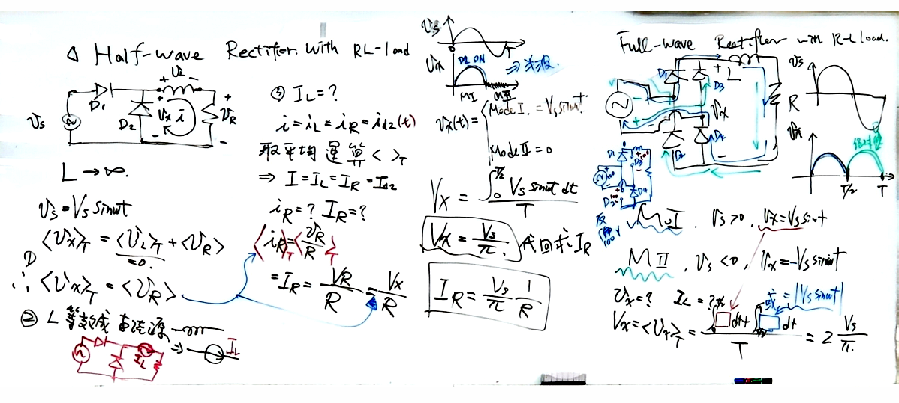
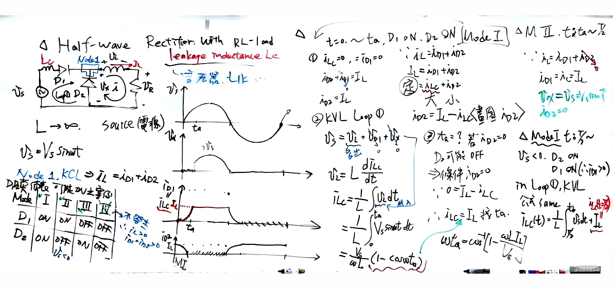
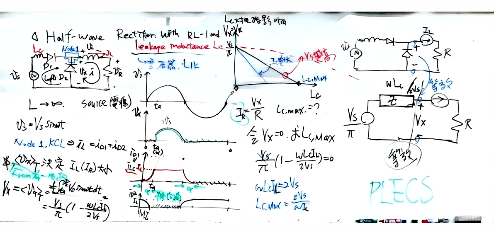
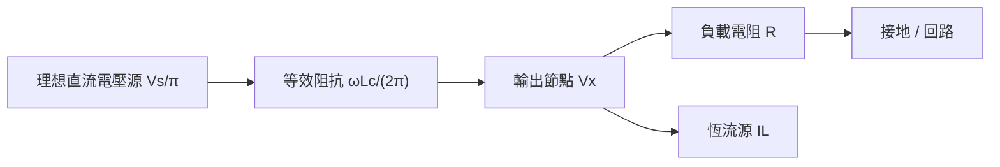
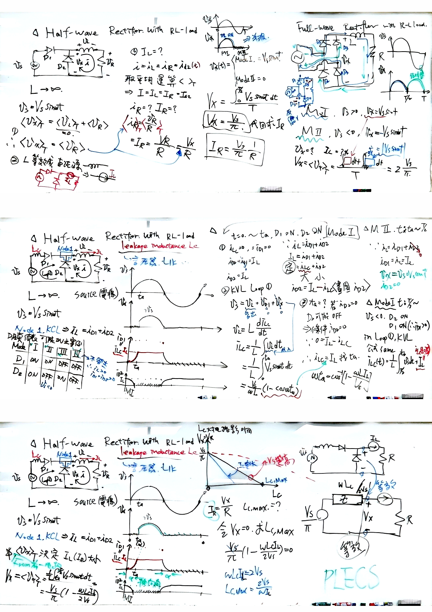

# 📅 2026-10-05 (週一)｜【電力電子】整流電路與漏感換流分析
> **科目**：`電力電子` ｜ **上課日期**：`2026-10-05` ｜ **原始檔案**：`原始檔案/電力電子/2026-10-05.pdf`

## 📌 3 分鐘核心摘要
- **純 RL 負載整流特性**：在負載電感趨於無窮大（ $L \to \infty$ ）時，負載電流為連續平滑的恆定直流源 $I_L$ ；半波整流平均輸出電壓為 $V_x = \frac{V_s}{\pi}$ ，全波整流則為 $2\frac{V_s}{\pi}$ 。
- **漏感（ $L_c$ ）換流重疊現象**：考慮交流側漏感後，二極體無法瞬間完成換向，在 $0 \le t \le t_a$ 期間 $D_1$ 與 $D_2$ 同時導通，造成換流重疊（Commutation overlap）。
- **換流角與電壓跌落**：換流角滿足 $\omega t_a = \cos^{-1}\left(1 - \frac{\omega L_c I_L}{V_s}\right)$ ，因漏感儲能延遲電流轉移，造成平均輸出電壓下降為 $V_x = \frac{V_s}{\pi} - \frac{\omega L_c I_L}{2\pi}$ 。
- **極限條件與等效模型**：當換流重疊角達到極限使平均電壓 $V_x = 0$ 時，漏感最大允許值為 $L_{c,\max} = \frac{2V_s}{\omega I_L}$ ；交流漏感效應可等效為直流側串聯一個阻抗為 $\frac{\omega L_c}{2\pi}$ 的壓降元件。

---

## 📖 結構化重點筆記（含自動剪貼圖表）
# 電力電子：整流電路與漏感換向分析

## 一、 RL 負載之整流電路基礎（無漏感）

> 🖼️ **半波與全波 RL 負載整流電路及波形分析**（擷取自第 1 頁）
> 

### 1. 半波整流電路（Half-wave Rectifier with RL-load）
- **電路假設**：
 - 輸入電源 $v_s(t) = V_s \sin(\omega t)$ 
 - 負載電感 $L \to \infty$ ，電流平波至完全連續直流 $i(t) = i_L = I_L$ ，可等效為恆流源 $I_L$ 。
- **電壓平均值分析**：
 - 由電感伏秒平衡特性，一個週期內電感平均電壓為零： $\langle v_L \rangle_T = 0$ 
 - 負載平均電壓與電阻平均電壓相等： $\langle v_x \rangle_T = \langle v_R \rangle_T = V_x$ 
- **模式分析**：
 - **Mode I**（ $0 \le \omega t \le \pi$ ）：二極體 $D_1$ ON，續流二極體 $D_2$ OFF， $v_x(t) = V_s \sin(\omega t)$ 
 - **Mode II**（ $\pi \le \omega t \le 2\pi$ ）： $D_1$ OFF， $D_2$ ON， $v_x(t) = 0$ 
- **輸出平均值**：

$$
V_x = \frac{1}{T} \int_{0}^{T/2} V_s \sin(\omega t) \, dt = \frac{V_s}{\pi}
$$

$$
I_R = I_L = \frac{V_x}{R} = \frac{V_s}{\pi R}
$$

### 2. 全波整流電路（Full-wave Rectifier with RL-load）
- 交流全波橋式電路在正負半週均導通輸出：
 - 正半週（ $v_s > 0$ ）： $v_x = V_s \sin(\omega t)$ 
 - 負半週（ $v_s < 0$ ）： $v_x = -V_s \sin(\omega t)$ 
- **全波輸出平均電壓**：

$$
V_x = \langle v_x \rangle_T = \frac{1}{T} \int_0^T |V_s \sin(\omega t)| \, dt = \frac{2 V_s}{\pi}
$$

---

## 二、 考慮交流側漏感之半波整流電路（Commutation Overlap）

> 🖼️ **具交流漏感 Lc 之半波整流換流過程與電流波形**（擷取自第 1 頁）
> 

在實際交流電源中，變壓器或線路存在漏感 $L_c$ （Leakage Inductance），造成電流無法瞬間切換。

### 1. 二極體導通狀態表與節點電流定律（KCL）
在節點 1 滿足：

$$
i_L = i_{D1} + i_{D2} = I_L \quad (\text{常數})
$$

| Mode | $D_1$ 狀態 | $D_2$ 狀態 | 物理現象說明 |
| :--- | :--- | :--- | :--- |
| **Mode I** | ON | ON | **換流重疊區**（ $0 \le t \le t_a$ ）， $D_1, D_2$ 同時導通 |
| **Mode II** | ON | OFF | 換流結束， $i_{D1} = I_L, i_{D2} = 0$ ，維持至 $t = \frac{T}{2}$ |
| **Mode III** | OFF | ON | 負半週續流（ $v_s < 0$ ）， $i_{D2} = I_L$ |
| **Mode IV** | OFF | OFF | 不發生（因負載具恆流特性，必有二極體導通） |

### 2. 換流區間數學推導（Mode I： $0 \le t \le t_a$ ）
- **初始條件**：在 $t = 0$ 瞬間， $i_{Lc}(0) = 0$ ，續流電流 $i_{D2}(0) = I_L$ 。
- **迴路 KVL**：
 由於 $D_2$ 導通， $v_x(t) = 0$ ，故漏感端電壓等於輸入電源：

$$
v_s(t) = v_{Lc}(t) = L_c \frac{d i_{Lc}}{dt}
$$

- **漏感電流上升推導**：

$$
i_{Lc}(t) = \frac{1}{L_c} \int_0^t V_s \sin(\omega t) \, dt = \frac{V_s}{\omega L_c} \left(1 - \cos(\omega t)\right)
$$

- 續流二極體電流隨之下降： $i_{D2}(t) = I_L - i_{Lc}(t)$ 。
- **換流結束時刻（ $t = t_a$ ）**：
 當 $i_{Lc}(t_a) = I_L$ 且 $i_{D2}(t_a) = 0$ 時，二極體 $D_2$ 截止，換流完成：

$$
I_L = \frac{V_s}{\omega L_c} \left(1 - \cos(\omega t_a)\right)
$$

$$
\omega t_a = \cos^{-1}\left(1 - \frac{\omega L_c I_L}{V_s}\right)
$$

---

## 三、 漏感對平均輸出電壓之影響與等效電路

> 🖼️ **漏感對輸出電壓影響、特性曲線與直流等效電路**（擷取自第 1 頁）
> 

### 1. 平均電壓推導
因為在 $0 \le t \le t_a$ 區間內 $v_x(t) = 0$ ，只有在 $t_a \le t \le \frac{T}{2}$ 區間內 $v_x(t) = V_s \sin(\omega t)$ ，因此整流輸出平均電壓為：

$$
V_x = \langle v_x \rangle_T = \frac{1}{T} \int_{t_a}^{T/2} V_s \sin(\omega t) \, dt = \frac{V_s}{2\pi} \left(1 + \cos(\omega t_a)\right)
$$

將 $\cos(\omega t_a) = 1 - \frac{\omega L_c I_L}{V_s}$ 代入：

$$
V_x = \frac{V_s}{\pi} \left(1 - \frac{\omega L_c I_L}{2 V_s}\right) = \frac{V_s}{\pi} - \frac{\omega L_c I_L}{2\pi}
$$

### 2. 最大容許漏感（ $L_{c,\max}$ ）
若漏感過大，換流時間持續整整半個週期（即 $V_x = 0$ ），電路喪失輸出能力：

$$
V_x = 0 \implies 1 - \frac{\omega L_{c,\max} I_L}{2 V_s} = 0 \implies L_{c,\max} = \frac{2 V_s}{\omega I_L}
$$

### 3. 直流等效電路模型
交流側的漏感換向壓降效應，在平均直流模型中可等效為串聯一個等效壓降電阻 $R_{eq}$ ：
- 理想直流無載電壓源： $V_{x0} = \frac{V_s}{\pi}$ 
- 等效內阻壓降： $\Delta V_x = \frac{\omega L_c}{2\pi} I_L$ 
- 負載電阻： $R$ 



---

## 🖼️ 原始板書/講義高畫質對照（已自動去陰影與銳利化）
<details>
<summary>👉 點此展開查看完整板書原圖（共 2 頁）</summary>

#### 📄 第 1 頁


#### 📄 第 2 頁


</details>

---

## 💡 後續複習提示詞 (Prompt)
```markdown
你現在是「電力電子」領域的教學專家。請根據上述「整流電路與漏感換流分析」的筆記內容，出 3 題觀念驗證題（包含 1 題陷阱選擇題與 2 題推導/問答題），並附上詳細詳解與評分標準。
```
