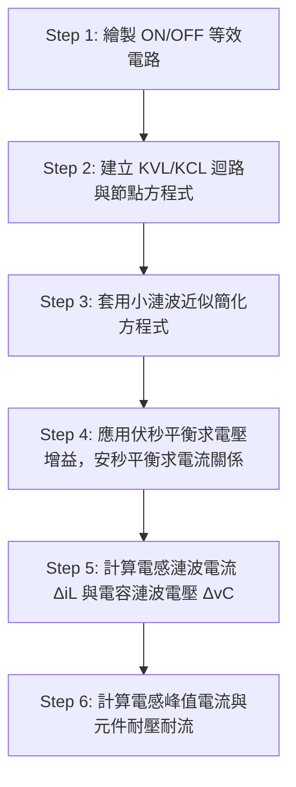
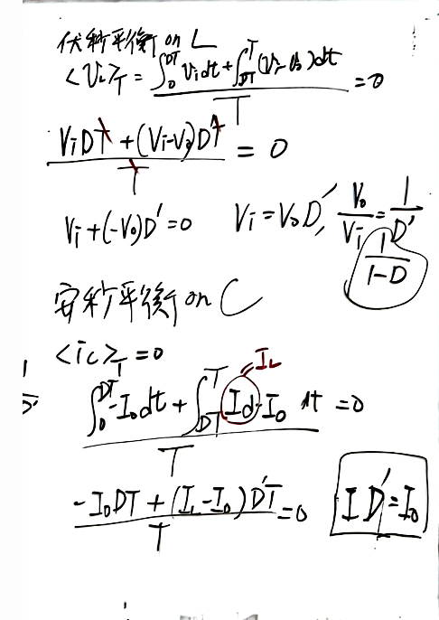

# 📅 2026-10-12 (週一)｜【電力電子】DC-DC轉換器穩態分析法
> **科目**：`電力電子` ｜ **上課日期**：`2026-10-12` ｜ **原始檔案**：`原始檔案/電力電子/2026-10-12.pdf`

## 📌 3 分鐘核心摘要
* **穩態分析六步驟架構**：藉由開關導通與截止的等效電路，配合 KVL/KCL 與小漣波近似（Small-ripple approximation），建立轉換器分析基礎。
* **電感伏秒平衡（Volt-second Balance）**：電感於穩態時一個週期內的平均電壓為零（ $\langle v_L \rangle = 0$ ），據此求得轉換器之電壓轉換比（電壓增益 $M(D)$ ）。
* **電容安秒平衡（Amp-second Balance）**：電容於穩態時一個週期內的平均電流為零（ $\langle i_C \rangle = 0$ ），據此推導電感平均電流與輸出電流之關係。
* **漣波分析與元件參數設計**：利用電感伏秒積分推導電感電流漣波峰對峰值 $\Delta i_L$ ，並依據電容電荷累積量 $\Delta Q$ 推導電容電壓漣波 $\Delta v_C$ 。

---

## 📖 結構化重點筆記（含自動剪貼圖表）
# DC-DC 轉換器穩態分析原理與實務

## 1. 穩態分析基本假設與步驟

### 1.1 基本假設（Step 0）
1. 轉換器運作於**穩態（Steady-state）**。
2. 電感電流保持同方向且連續（CCM，Continuous Conduction Mode）。
3. 電容值夠大，使輸出電壓接近常數，即滿足**小漣波近似（Small-ripple approximation）**：
 

$$
v_o(t) \approx V_o \quad (\Delta v_o \ll V_o)
$$

4. 開關週期為 $T$ ，責任週期（Duty cycle）為 $D$ ：
 * 開關導通（ON）時間為 $D T$ 
 * 開關截止（OFF）時間為 $D' T = (1 - D) T$ （其中 $D + D' = 1$ ）
5. 所有開關與被動元件均視為理想元件。

### 1.2 穩態分析標準流程


---

## 2. 降壓轉換器（Buck Converter）詳細分析

> 🖼️ **Buck 轉換器電路架構與 ON/OFF 等效迴路分析**（擷取自第 1 頁）
> 

### 2.1 等效電路與狀態方程式
* **區間 1：開關 $Q_1$ ON（ $0 \le t < DT$ ）**
 * 二極體 $D_1$ 逆向偏壓截止。
 * KVL（迴路）：
 

$$
V_i = v_L + v_o \implies v_L = V_i - V_o
$$

 * KCL（節點）：
 

$$
i_L = i_C + i_o \implies i_C = i_L - I_o
$$

* **區間 2：開關 $Q_1$ OFF（ $DT \le t < T$ ）**
 * 二極體 $D_1$ 順向導通續流。
 * KVL（迴路）：
 

$$
v_L + v_o = 0 \implies v_L = -V_o
$$

 * KCL（節點）：
 

$$
i_L = i_C + i_o \implies i_C = i_L - I_o
$$

### 2.2 伏秒平衡求電壓增益（Step 4）
電感穩態平均電壓為零：

$$
\langle v_L \rangle = \frac{1}{T} \int_{0}^{T} v_L(t) \, dt = 0
$$

$$
\frac{(V_i - V_o) D T + (-V_o) D' T}{T} = 0
$$

$$
(V_i - V_o) D - V_o D' = 0 \implies V_i D = V_o (D + D') = V_o
$$

得電壓轉換比：

$$
M(D) = \frac{V_o}{V_i} = D
$$

### 2.3 安秒平衡求電流關係
1. **輸出電容安秒平衡**：
 

$$
\langle i_C \rangle = \frac{1}{T} \left[ \int_{0}^{DT} (I_L - I_o) \, dt + \int_{DT}^{T} (I_L - I_o) \, dt \right] = 0
$$

 

$$
I_L - I_o = 0 \implies I_L = I_o = \frac{V_o}{R}
$$

2. **輸入電容 / 輸入電流安秒平衡**：
 * ON 期間： $i_{Q1} = i_L \approx I_L$ ， $i_{Ci} = I_i - I_L$ 
 * OFF 期間： $i_{Q1} = 0$ ， $i_{Ci} = I_i$ 
 

$$
\langle i_{Ci} \rangle = \frac{(I_i - I_L) D T + I_i D' T}{T} = 0
$$

 

$$
I_i - I_L D = 0 \implies I_i = D I_L = D I_o
$$

---

## 3. 漣波分析與元件規格計算（Step 5 & Step 6）

> 🖼️ **Buck 轉換器電感電流與電容電流/電荷幾何面積積分圖**（擷取自第 2 頁）
> 

### 3.1 電感電流漣波 $\Delta i_L$ 
由電感微分方程式 $v_L = L \frac{di_L}{dt}$ ：
* 在 ON 期間電感電流線性上升：
 

$$
\Delta i_L = \frac{1}{L} \int_{0}^{DT} v_L \, dt = \frac{1}{L} (V_i - V_o) D T
$$

* 在 OFF 期間電感電流線性下降：
 

$$
\Delta i_L = -\frac{1}{L} (-V_o) D' T = \frac{V_o}{L} D' T
$$

電感峰值電流為：

$$
I_{L,\text{pk}} = I_L + \frac{\Delta i_L}{2}
$$

### 3.2 電容電壓漣波 $\Delta v_C$ （考慮有限電容量）
電容電流 $i_C = i_L - I_o$ 為對稱三角形波形，在半週期內累積電荷 $\Delta Q$ ：
* 幾何三角形底寬為 $\frac{T}{2}$ ，高為 $\frac{\Delta i_L}{2}$ ：
 

$$
\Delta Q = \frac{1}{2} \times \left( \frac{T}{2} \right) \times \left( \frac{\Delta i_L}{2} \right) = \frac{T \Delta i_L}{8}
$$

* 輸出漣波電壓峰對峰值：
 

$$
\Delta v_C = \frac{\Delta Q}{C} = \frac{(V_i - V_o) D T^2}{8 L C} = \frac{(V_i - V_o) D}{8 L C f_s^2}
$$

---

## 4. 升壓轉換器（Boost Converter）穩態平衡比較

> 🖼️ **Boost 轉換器伏秒平衡與安秒平衡推導**（擷取自第 2 頁）
> 

* **電感伏秒平衡**：
 

$$
\langle v_L \rangle = \frac{V_i D T + (V_i - V_o) D' T}{T} = 0
$$

 

$$
V_i - V_o D' = 0 \implies \frac{V_o}{V_i} = \frac{1}{D'} = \frac{1}{1 - D}
$$

* **輸出電容安秒平衡**：
 * ON 期間：二極體截止， $i_C = -I_o$ 
 * OFF 期間：二極體導通， $i_C = I_L - I_o$ 
 

$$
\langle i_C \rangle = \frac{-I_o D T + (I_L - I_o) D' T}{T} = 0
$$

 

$$
-I_o + I_L D' = 0 \implies I_L D' = I_o \iff I_L = \frac{I_o}{1 - D}
$$

* **Boost 輸出漣波電壓估算**：
 在開關導通時，輸出電容單獨放電供應負載：
 

$$
\Delta Q = I_o D T \implies \Delta v_C = \frac{I_o D T}{C} = \frac{V_o D}{R C f_s}
$$

---

## 🖼️ 原始板書/講義高畫質對照（已自動去陰影與銳利化）
<details>
<summary>👉 點此展開查看完整板書原圖（共 2 頁）</summary>

#### 📄 第 1 頁


#### 📄 第 2 頁


</details>

---

## 💡 後續複習提示詞 (Prompt)
```markdown
你現在是「電力電子」領域的教學專家。請根據上述「DC-DC轉換器穩態分析法」的筆記內容，出 3 題觀念驗證題（包含 1 題陷阱選擇題與 2 題推導/問答題），並附上詳細詳解與評分標準。
```
