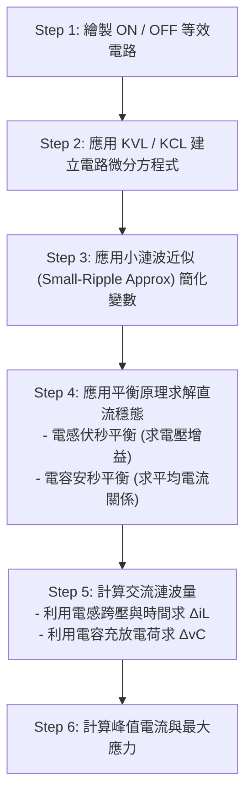
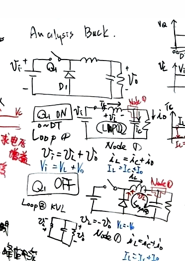
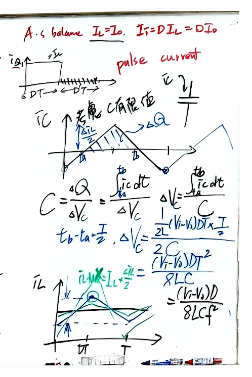

# 📅 2026-10-12 (週一)｜【電力電子】穩態轉換器分析法與 Buck/Boost 轉換器
> **科目**：`電力電子` ｜ **上課日期**：`2026-10-12` ｜ **原始檔案**：`原始檔案/電力電子/2026-10-12.pdf`

## 📌 3 分鐘核心摘要
- **穩態分析基本假設與步驟**：在連續導通模式（CCM）與小漣波近似（Small-Ripple Approximation）假設下，透過伏秒平衡（Volt-second Balance）與安秒平衡（Amp-second Balance）求解直流轉換比與電流關係。
- **降壓轉換器（Buck Converter）分析**：推導出電壓增益 $M(D) = D$ 、平均電感電流 $I_L = I_o$ 、輸入電流 $I_i = D I_L$ ，以及考慮有限電容值時的輸出電壓漣波公式 $\Delta v_C = \frac{(V_i - V_o)D}{8LC f_s^2}$ 。
- **升壓轉換器（Boost Converter）分析**：利用電感伏秒平衡推導增益 $M(D) = \frac{1}{1-D}$ ，利用輸出電容安秒平衡推導電感電流 $I_L = \frac{I_o}{1-D}$ ，並分析電容放電之電壓漣波 $\Delta v_C = \frac{I_o DT}{C}$ 。

---

## 📖 結構化重點筆記（含自動剪貼圖表）
# 穩態轉換器分析原理與降壓/升壓轉換器分析

## 1. 穩態分析的基本假設（Fundamental Assumptions）

在進行切換式轉換器的穩態分析前，須先滿足以下五大基本假設：
1. **穩態操作（Steady-state operation）**：所有電壓與電流波形在一個週期前後具週期性重複（即 $x(t+T) = x(t)$ ）。
2. **連續導通模式（CCM）**：電感電流維持同方向流動且不歸零（Continuous Inductor Current）。
3. **小漣波近似（Small-ripple approximation）**：
 - 濾波電容足夠大，輸出電壓近似定值： $V_o \approx \text{const}$ ，其漣波 $\Delta v_o \ll V_o$ （例如： $V_o = 3.3\text{ V}, \Delta v_o = 10\text{ mV}$ ）。
 - 電抗特性極限： $X_L \to \infty$ （電感電流交流漣波小 $\Delta i_L \approx 0$ ）， $X_C \to 0$ （電容電壓交流漣波小 $\Delta v_C \approx 0$ ）。
4. **週期與切換時間**：切換週期為 $T$ ，開關導通時間為 $DT$ ，關斷時間為 $(1-D)T = D'T$ ，滿足 $D + D' = 1$ （其中 $D$ 為責任週期 Duty Cycle）。
5. **理想元件**：所有半導體開關、二極體、電感與電容皆為無損耗的理想元件。

---

## 2. 穩態分析六大標準步驟（Analysis Procedure）



---

## 3. 降壓轉換器（Buck Converter）詳細分析

> 🖼️ **Buck 轉換器拓撲與 ON/OFF 等效電路**（擷取自第 1 頁）
> 

### 3.1 等效電路與方程式建立

#### (1) 開關導通期間（ $Q_1$ ON，時間區間： $0 \le t < DT$ ）
- 開關導通，二極體 $D_1$ 逆向偏壓截止。
- **KVL**（電感迴路）：
 

$$
V_i = v_L + v_o \implies v_L = V_i - V_o
$$

- **KCL**（輸出節點）：
 

$$
i_L = i_C + i_o \implies I_L = I_C + I_o
$$

#### (2) 開關關斷期間（ $Q_1$ OFF，時間區間： $DT \le t < T$ ）
- 開關截止，二極體 $D_1$ 因電感續流順向導通。
- **KVL**（電感迴路）：
 

$$
v_L = -v_o \implies v_L = -V_o
$$

- **KCL**（輸出節點）：
 

$$
i_L = i_C + i_o \implies I_L = I_C + I_o
$$

---

### 3.2 伏秒平衡與安秒平衡（Step 4）

#### (1) 電感伏秒平衡（Volt-Second Balance on $L$ ）
穩態下電感在一週期內之平均電壓必為零：

$$
\langle v_L \rangle_T = \frac{1}{T} \int_0^T v_L(t) \, dt = 0
$$

代入各區間跨壓：

$$
\frac{(V_i - V_o) DT + (-V_o) D'T}{T} = 0
$$

$$
(V_i - V_o) D - V_o D' = 0 \implies V_i D = V_o (D + D')
$$

因為 $D + D' = 1$ ，可得電壓增益轉換比（Voltage Gain）：

$$
M(D) = \frac{V_o}{V_i} = D
$$

#### (2) 輸出電容安秒平衡（Amp-Second Balance on $C$ ）
穩態下電容在一週期內之平均電流必為零：

$$
\langle i_C \rangle_T = \frac{1}{T} \int_0^T i_C(t) \, dt = 0
$$

由於 $i_C = i_L - i_o \approx I_L - I_o$ ：

$$
\frac{(I_L - I_o) DT + (I_L - I_o) D'T}{T} = 0 \implies I_L - I_o = 0
$$

得出平均電感電流：

$$
I_L = I_o = \frac{V_o}{R}
$$

#### (3) 輸入端電容安秒平衡（求輸入平均電流 $I_i$ ）
開關電流 $i_{Q1}$ 為脈衝電流（Pulse current）：
- $0 \le t < DT$ 期間： $i_{Q1} = i_L \approx I_L$ ，節點電流關係為 $I_i = I_{C1} + I_L \implies I_{C1} = I_i - I_L$ 
- $DT \le t < T$ 期間： $i_{Q1} = 0$ ，節點電流關係為 $I_{C1} = I_i$ 

對輸入濾波電容 $C_1$ 套用安秒平衡：

$$
\langle i_{C1} \rangle = \frac{(I_i - I_L) DT + I_i D'T}{T} = 0
$$

$$
I_i (D + D') - I_L D = 0 \implies I_i = D I_L = D I_o
$$

---

### 3.3 電流與電壓漣波分析（Step 5 & 6）

> 🖼️ **Buck 轉換器電感漣波與電容電荷幾何分析**（擷取自第 2 頁）
> 

#### (1) 電感電流漣波（ $\Delta i_L$ ）
由電感基本特性 $v_L = L \frac{d i_L}{dt}$ ：
- 導通時充磁電流上升量：
 

$$
\Delta i_L^+ = \frac{1}{L} \int_0^{DT} (V_i - V_o) \, dt = \frac{(V_i - V_o) DT}{L} > 0
$$

- 關斷時退磁電流下降量：
 

$$
\Delta i_L^- = \frac{1}{L} \int_{DT}^T (-V_o) \, dt = \frac{-V_o D'T}{L} < 0
$$

- 電感電流峰值（Peak Current）：
 

$$
i_{L,\max} = I_L + \frac{\Delta i_L}{2}
$$

#### (2) 輸出電壓漣波（ $\Delta v_C$ / $\Delta v_o$ ）
當考慮電容為有限值時，流入電容之交流電流 $i_C(t) = i_L(t) - I_o$ 為對稱三角形波形，其峰對峰值為 $\Delta i_L$ 。

- 正半波累積電荷 $\Delta Q$ 即為上半部三角形面積：
 - 三角形底邊時間寬度： $t_b - t_a = \frac{T}{2}$ 
 - 三角形高： $\frac{\Delta i_L}{2}$ 
 - 累積總電荷量：
 

$$
\Delta Q = \frac{1}{2} \times \left( \frac{T}{2} \right) \times \left( \frac{\Delta i_L}{2} \right) = \frac{T \Delta i_L}{8}
$$

- 輸出電壓漣波大小：
 

$$
\Delta v_C = \frac{\Delta Q}{C} = \frac{T \Delta i_L}{8C} = \frac{(V_i - V_o) DT^2}{8LC} = \frac{(V_i - V_o) D}{8LC f_s^2}
$$

 （其中 $f_s = \frac{1}{T}$ 為切換頻率）

---

## 4. 升壓轉換器（Boost Converter）穩態分析

### 4.1 電感伏秒平衡
- 開關導通期間（ $DT$ ）：電感直接接於輸入端，跨壓為 $v_L = V_i$ 。
- 開關關斷期間（ $D'T$ ）：二極體導通，跨壓為 $v_L = V_i - V_o$ 。

由伏秒平衡條件：

$$
\langle v_L \rangle_T = \frac{1}{T} \left( \int_0^{DT} V_i \, dt + \int_{DT}^T (V_i - V_o) \, dt \right) = 0
$$

$$
V_i DT + (V_i - V_o) D'T = 0 \implies V_i (D + D') - V_o D' = 0
$$

$$
V_i = V_o D' \implies M(D) = \frac{V_o}{V_i} = \frac{1}{D'} = \frac{1}{1-D}
$$

### 4.2 輸出電容安秒平衡
- 開關導通期間（ $DT$ ）：二極體逆偏截止，電容單獨向負載放電， $i_C = -I_o$ 。
- 開關關斷期間（ $D'T$ ）：電感電流流經二極體為電容充電並供應負載， $i_C = I_L - I_o$ 。

由安秒平衡條件：

$$
\langle i_C \rangle_T = \frac{1}{T} \left( \int_0^{DT} (-I_o) \, dt + \int_{DT}^T (I_L - I_o) \, dt \right) = 0
$$

$$
-I_o DT + (I_L - I_o) D'T = 0 \implies I_L D' - I_o (D + D') = 0
$$

$$
I_L D' = I_o \implies I_L = \frac{I_o}{D'} = \frac{I_o}{1-D}
$$

### 4.3 升壓轉換器電壓漣波
在開關導通期間（ $DT$ ），電容單獨放電供應負載電流 $I_o$ ，流失電荷量為：

$$
\Delta Q^- = -I_o DT
$$

因此輸出電壓漣波大小為：

$$
\Delta v_C = \frac{|\Delta Q^-|}{C} = \frac{I_o DT}{C} = \frac{V_o DT}{RC}
$$

---

## 🖼️ 原始板書/講義高畫質對照（已自動去陰影與銳利化）
<details>
<summary>👉 點此展開查看完整板書原圖（共 2 頁）</summary>

#### 📄 第 1 頁


#### 📄 第 2 頁


</details>

---

## 💡 後續複習提示詞 (Prompt)
```markdown
你現在是「電力電子」領域的教學專家。請根據上述「穩態轉換器分析法與 Buck/Boost 轉換器」的筆記內容，出 3 題觀念驗證題（包含 1 題陷阱選擇題與 2 題推導/問答題），並附上詳細詳解與評分標準。
```
