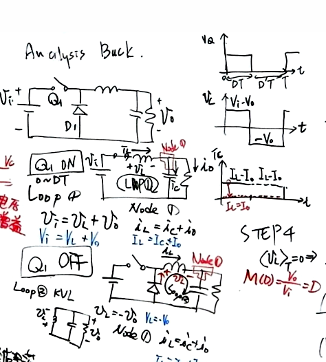
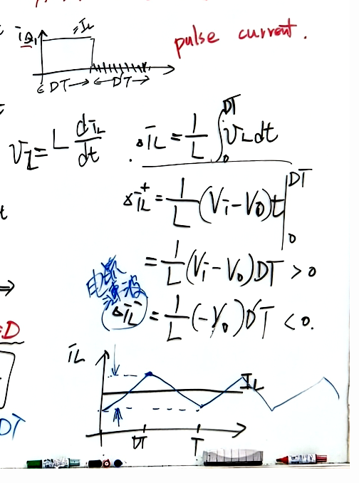
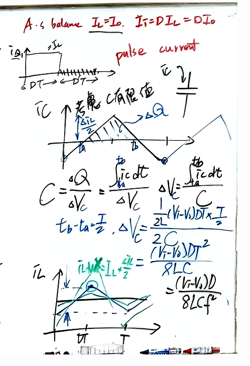
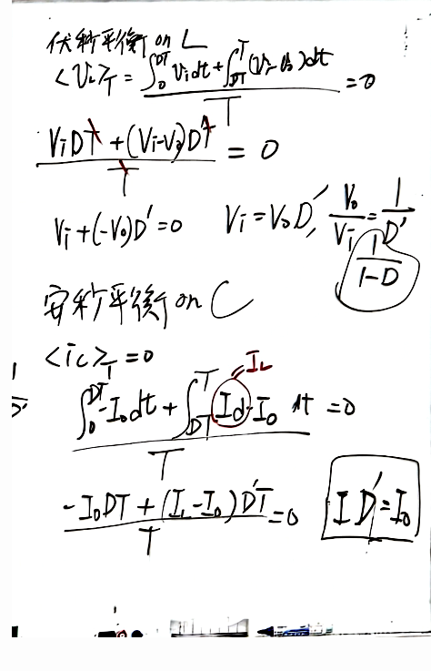
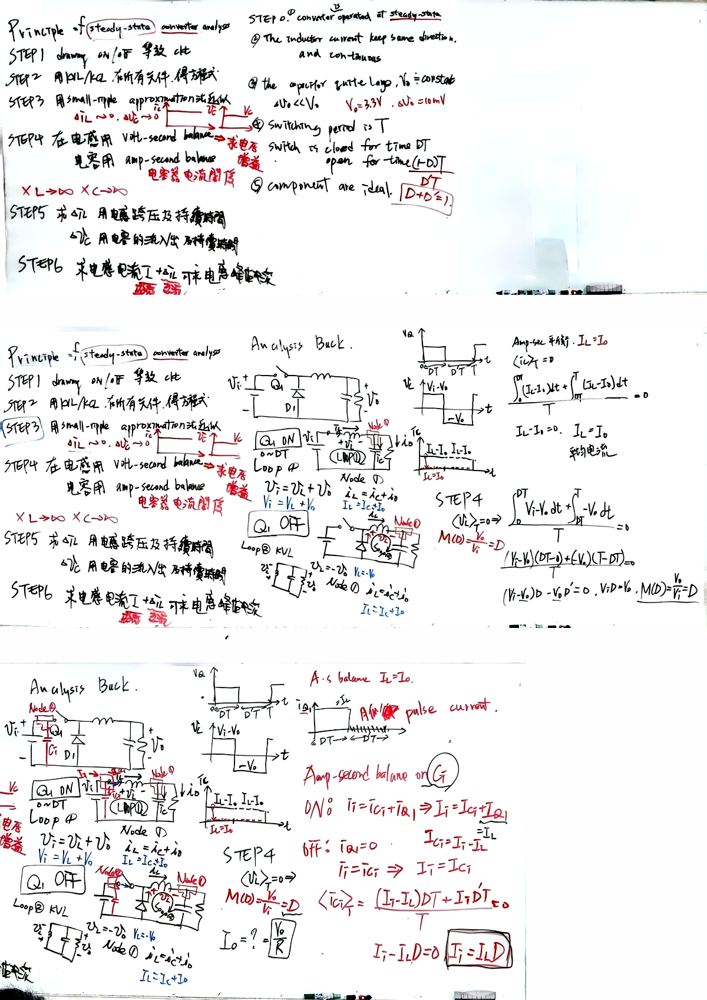
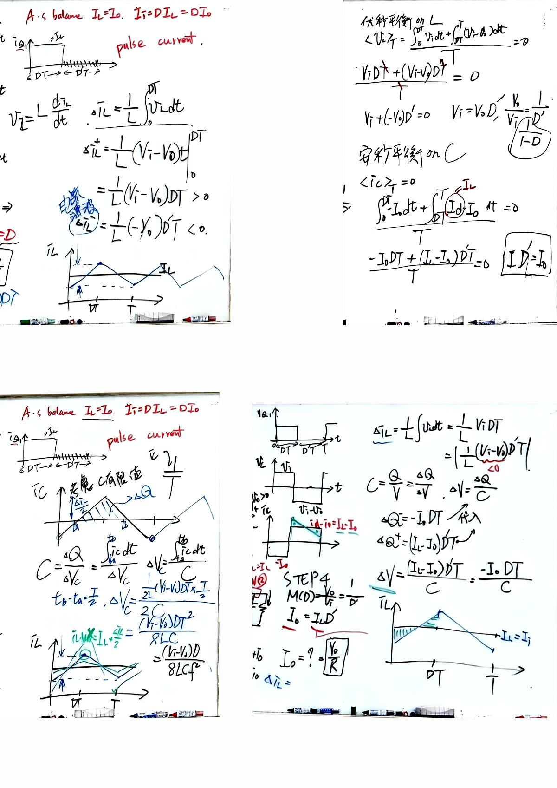

# 📅 2026-10-18 (週日)｜【電力電子】DC-DC 轉換器穩態分析原理（Buck 與 Boost）
> **科目**：`電力電子` ｜ **上課日期**：`2026-10-18` ｜ **原始檔案**：`原始檔案/電力電子/2026-10-18.pdf`

## 📌 3 分鐘核心摘要
- **分析基本架構**：奠基於小漣波近似（Small-ripple approximation）、電感連續導通（CCM）及電容大容量假設，依循六大標準步驟求解穩態響應。
- **伏秒與安秒平衡**：電感平均跨壓為零（伏秒平衡）決定電壓轉換率 $M(D)$ ；電容平均電流為零（安秒平衡）決定直流電流分配關係。
- **Buck 轉換器推導**：推得電壓比 $M(D) = D$ 、電感電流平均值 $I_L = I_o$ ，電壓漣波藉由電容三角波電荷面積積分求得 $\Delta v_C = \frac{(V_i - V_o) D}{8 L C f^2}$ 。
- **Boost 轉換器推導**：推得升壓比 $M(D) = \frac{1}{1-D}$ 、電感電流平均值 $I_L = \frac{I_o}{1-D}$ ，並求得電容充放電之電壓漣波。

---

## 📖 結構化重點筆記（含自動剪貼圖表）
## 一、 穩態轉換器分析核心原則（Principle of Steady-State Converter Analysis）

### 1. 基本假設（Step 0）
- 轉換器運作於**穩態（Steady-state）**。
- 電感電流方向固定且連續（**CCM**, Continuous Conduction Mode）。
- 輸出電容夠大使得輸出電壓近乎恆定，即小漣波近似（Small-ripple approximation）：

$$
\Delta v_o \ll V_o \quad (\text{例：} V_o = 3.3\text{ V}, \Delta v_o = 10\text{ mV})
$$

- 切換週期為 $T$ ，開關導通時間為 $D T$ ，開關截止時間為 $(1-D) T = D' T$ （其中 $D + D' = 1$ ）。
- 電路中所有開關與被動元件均視為理想元件。

### 2. 六大標準分析步驟
- **STEP 1**：分別畫出開關導通（ON）與截止（OFF）之等效電路。
- **STEP 2**：在各狀態電路中使用 KVL 與 KCL 建立所有元件之方程式。
- **STEP 3**：利用小漣波近似，令 $\Delta i_L \approx 0$ 、 $\Delta v_C \approx 0$ ，將狀態變數視為直流常數。
- **STEP 4**：
 - 對電感應用**伏秒平衡（Volt-second balance）**： $\langle v_L \rangle = 0$ ，求解電壓增益 $M(D) = \frac{V_o}{V_i}$ 。
 - 對電容應用**安秒平衡（Amp-second balance）**： $\langle i_C \rangle = 0$ ，求解電容與負載電流關係。
- **STEP 5**：計算漣波大小：
 - 利用電感跨壓與導通時間求電感電流漣波 $\Delta i_L$ 。
 - 利用電容充放電電流與時間求電壓漣波 $\Delta v_C$ 。
- **STEP 6**：結合電感直流電流 $I_L$ 與 $\Delta i_L$ ，求出電感峰值電流 $I_{L,\text{peak}} = I_L + \frac{\Delta i_L}{2}$ 。

---

## 二、 降壓轉換器（Buck Converter）詳細分析

> 🖼️ **Buck 轉換器電路、ON/OFF 等效模型與各節點波形**（擷取自第 1 頁）
> 

### 1. 導通與截止狀態方程式
- ** $Q_1$ ON 區間（ $0 \sim DT$ ）**：
 - 二極體 $D_1$ 逆向偏壓截止。
 - 電感跨壓： $v_L = V_i - V_o$ 
 - 節點電流： $i_L = i_C + i_o$ 
- ** $Q_1$ OFF 區間（ $DT \sim T$ ）**：
 - 二極體 $D_1$ 順向導通續流。
 - 電感跨壓： $v_L = -V_o$ 
 - 節點電流： $i_L = i_C + i_o$ 

### 2. 穩態平衡推導
- **伏秒平衡求電壓增益**：

$$
\langle v_L \rangle_T = \frac{1}{T} \left[ \int_0^{DT} (V_i - V_o) dt + \int_{DT}^T (-V_o) dt \right] = 0
$$

$$
(V_i - V_o) D - V_o D' = 0 \implies V_i D - V_o (D + D') = 0
$$

$$
M(D) = \frac{V_o}{V_i} = D
$$

- **安秒平衡求負載電流**：

$$
\langle i_C \rangle_T = \frac{1}{T} \left[ \int_0^{DT} (I_L - I_o) dt + \int_{DT}^T (I_L - I_o) dt \right] = 0 \implies I_L = I_o
$$

- **輸入電流關係**：
 電源端電流 $i_{Q1}$ 為脈衝波形（Pulse current），平均輸入電流為：

$$
I_i = \langle i_{Q1} \rangle = D I_L = D I_o
$$

### 3. 電感電流與輸出電壓漣波計算

> 🖼️ **Buck 電感電流波形與漣波推導**（擷取自第 2 頁）
> 

- **電感電流漣波 $\Delta i_L$ ** ：
 由 $v_L = L \frac{d i_L}{dt}$ ，在充電區間（ $0 \sim DT$ ）積分：

$$
\Delta i_L = \frac{1}{L} \int_0^{DT} v_L dt = \frac{1}{L} (V_i - V_o) DT
$$

 電感峰值電流為：

$$
I_{L,\max} = I_L + \frac{\Delta i_L}{2}
$$

> 🖼️ **Buck 電容電流幾何面積積分與輸出電壓漣波公式推導**（擷取自第 2 頁）
> 

- **輸出電壓漣波 $\Delta v_C$ ** ：
 流經電容的交流電流為以零為基準的三角波，其正半週累積電荷 $\Delta Q$ 即為電壓升高的來源：
 正半週持續時間為底 $\frac{T}{2}$ ，三角形高為 $\frac{\Delta i_L}{2}$ ：

$$
\Delta Q = \frac{1}{2} \times \left( \frac{T}{2} \right) \times \left( \frac{\Delta i_L}{2} \right) = \frac{T \Delta i_L}{8}
$$

 代入 $\Delta i_L = \frac{(V_i - V_o) D T}{L}$ ：

$$
\Delta v_C = \frac{\Delta Q}{C} = \frac{(V_i - V_o) D T^2}{8 L C} = \frac{(V_i - V_o) D}{8 L C f^2}
$$

---

## 三、 升壓轉換器（Boost Converter）穩態分析

> 🖼️ **Boost 轉換器電感伏秒平衡與電容安秒平衡公式推導**（擷取自第 2 頁）
> 

### 1. 伏秒平衡與電壓轉換比
- 在導通期間（ $0 \sim DT$ ）：電感充電， $v_L = V_i$ 
- 在截止期間（ $DT \sim T$ ）：電感釋能， $v_L = V_i - V_o$ 
- 電感伏秒平衡方程式：

$$
\langle v_L \rangle_T = \frac{V_i DT + (V_i - V_o) D'T}{T} = 0
$$

$$
V_i (D + D') - V_o D' = 0 \implies V_i = V_o D'
$$

$$
M(D) = \frac{V_o}{V_i} = \frac{1}{D'} = \frac{1}{1 - D}
$$

### 2. 安秒平衡與電流關係
- 在導通期間，二極體不通，電容獨自對負載放電： $i_C = -I_o$ 
- 在截止期間，電感電流流向輸出端： $i_C = I_L - I_o$ 
- 電容安秒平衡方程式：

$$
\langle i_C \rangle_T = \frac{-I_o DT + (I_L - I_o) D'T}{T} = 0 \implies I_L D' = I_o \implies I_L = \frac{I_o}{D'} = \frac{I_o}{1 - D}
$$

### 3. Boost 輸出電壓漣波
在導通期間 $0 \sim DT$ 內，電容釋放電荷量為：

$$
\Delta Q = I_o DT
$$

輸出電壓漣波大小為：

$$
\Delta v_C = \frac{\Delta Q}{C} = \frac{I_o DT}{C}
$$

---

## 🖼️ 原始板書/講義高畫質對照（已自動去陰影與銳利化）
<details>
<summary>👉 點此展開查看完整板書原圖（共 2 頁）</summary>

#### 📄 第 1 頁


#### 📄 第 2 頁


</details>

---

## 💡 後續複習提示詞 (Prompt)
```markdown
你現在是「電力電子」領域的教學專家。請根據上述「DC-DC 轉換器穩態分析原理（Buck 與 Boost）」的筆記內容，出 3 題觀念驗證題（包含 1 題陷阱選擇題與 2 題推導/問答題），並附上詳細詳解與評分標準。
```
