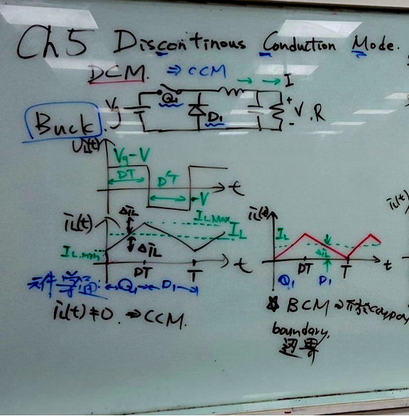
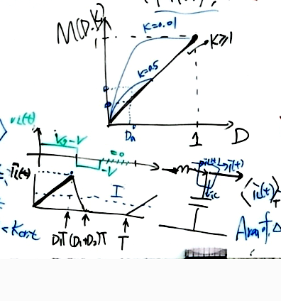
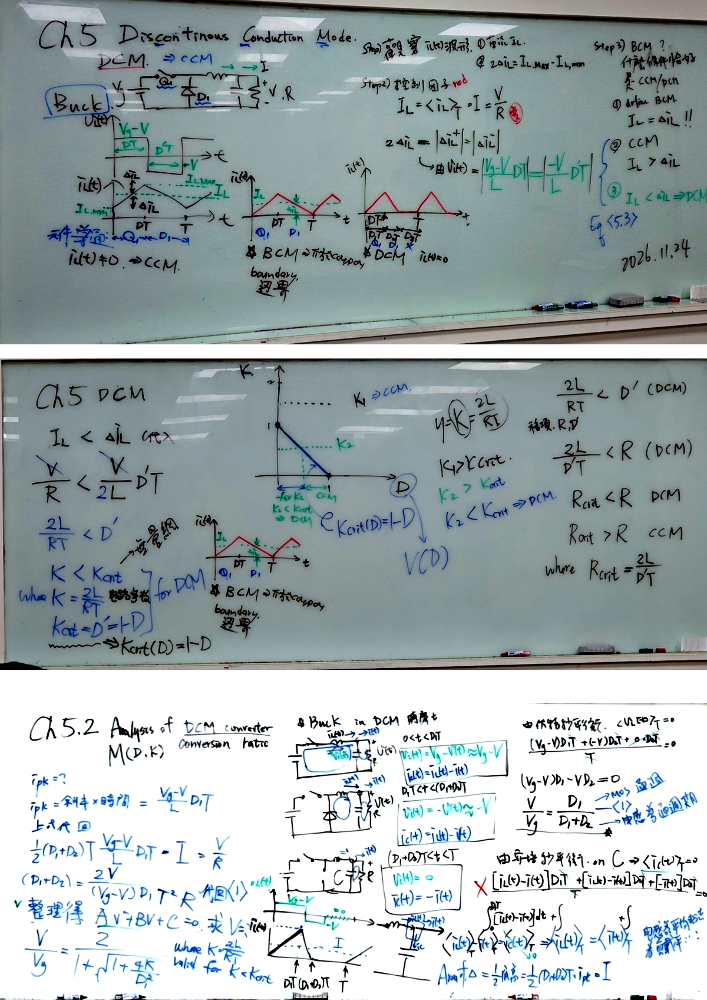
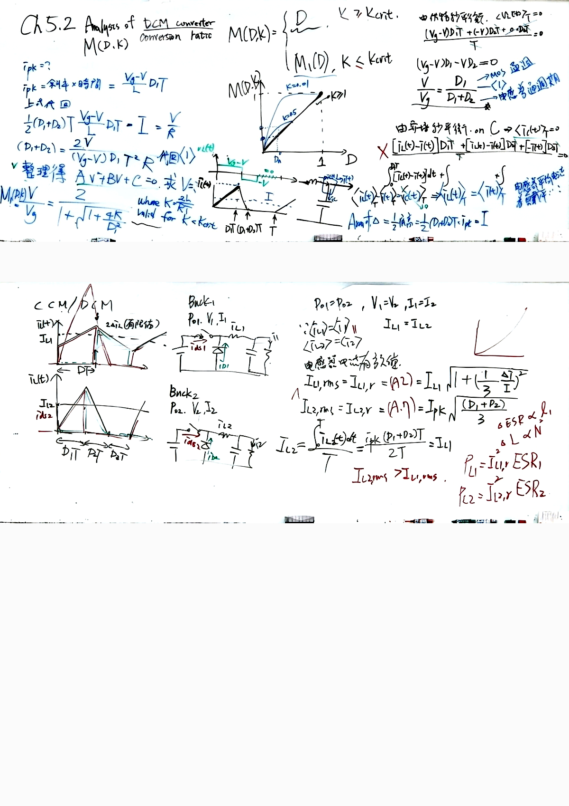

# 📅 2026-11-24 (週二)｜【電力電子】Buck 轉換器之 DCM 模式分析
> **科目**：`電力電子` ｜ **上課日期**：`2026-11-24` ｜ **原始檔案**：`incoming/電力電子/2026-11-24.pdf`

## 📌 3 分鐘核心摘要
- 探討 Buck 轉換器在不連續導通模式（ DCM ）下的電路運作特性與電感電流波形。
- 推導 DCM 下的轉換比 $M(D, K)$ ，並定義邊界條件與關鍵參數 $K$ 與 $K_{\text{crit}}$ 。
- 比較連續導通模式（ CCM ）與 DCM 的差異，並分析多個轉換器並聯時的均流與損耗特性。

---

## 📖 結構化重點筆記（含自動剪貼圖表）
## 1. 導通模式定義（ CCM 與 DCM ）
- 連續導通模式（ CCM ）：電感電流 $i_L(t)$ 在一個週期內恆大於 0 （即 $I_L > \Delta i_L$ ）。
- 不連續導通模式（ DCM ）：電感電流 $i_L(t)$ 在一個週期內會歸零（即 $I_L < \Delta i_L$ ）。
- 邊界導通模式（ BCM ）：介於 CCM 與 DCM 之間，此時峰值電流滿足 $2 \Delta i_L = I_{L,\text{max}} - I_{L,\text{min}}$ 。

> 🖼️ **Buck轉換器電路與 CCM/DCM 電感電流波形**（擷取自第 1 頁）
> 

## 2. DCM 轉換比 $M(D, K)$ 推導
- 在 DCM 下，電感電流波形包含三個區段： $0 < t < DT$ 、 $DT < t < (D_1 + D)T$ 以及 $(D_1 + D)T < t < T$ 。
- 峰值電流計算：
 

$$
i_{\text{pk}} = \text{斜率} \times \text{時間} = \frac{V_g - V}{L} DT
$$

- 利用電感伏秒平衡與負載電流關係，可得到二次方程式：
 

$$
A V^2 + B V + C = 0
$$

- 解得轉換比公式：
 

$$
M(D, K) = \frac{V}{V_g} = \frac{2}{1 + \sqrt{1 + \frac{4K}{D^2}}}
$$

 其中參數定義為 $K = \frac{2L}{R T}$ ，且此式有效條件為 $K < K_{\text{crit}}$ 。

> 🖼️ **DCM 轉換比曲線 $M(D, K)$ 及其邊界條件**（擷取自第 2 頁）
> 

## 3. 臨界條件與損耗分析
- 臨界參數：
 

$$
K_{\text{crit}}(D) = 1 - D = D'
$$

- 當 $K > K_{\text{crit}}$ 時為 CCM ；當 $K < K_{\text{crit}}$ 時為 DCM 。
- 功率損耗與漣波分析：
 電感電流均方根值（ RMS ）計算公式為：
 

$$
I_{L,r} = I_{L,rms} = I_{L1} \sqrt{1 + \left( \frac{1}{3} \frac{\Delta i}{I} \right)^2}
$$

---

## 🖼️ 原始板書/講義高畫質對照（已自動去陰影與銳利化）
<details>
<summary>👉 點此展開查看完整板書原圖（共 2 頁）</summary>

#### 📄 第 1 頁


#### 📄 第 2 頁


</details>

---

## 💡 後續複習提示詞 (Prompt)
```markdown
你現在是「電力電子」領域的教學專家。請根據上述「Buck 轉換器之 DCM 模式分析」的筆記內容，出 3 題觀念驗證題（包含 1 題陷阱選擇題與 2 題推導/問答題），並附上詳細詳解與評分標準。
```
