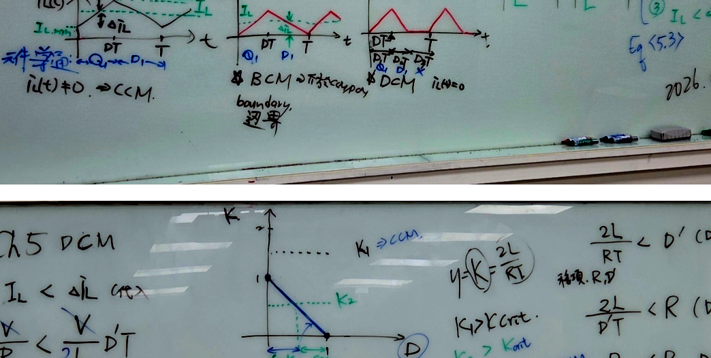
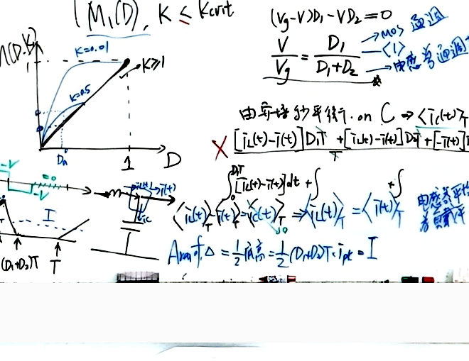
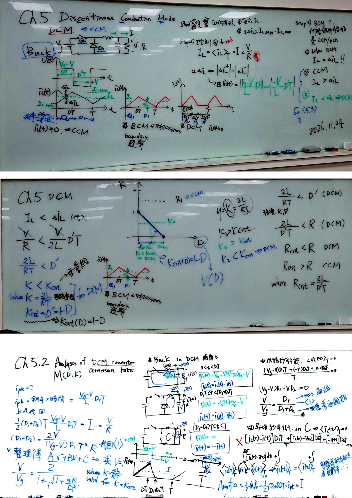
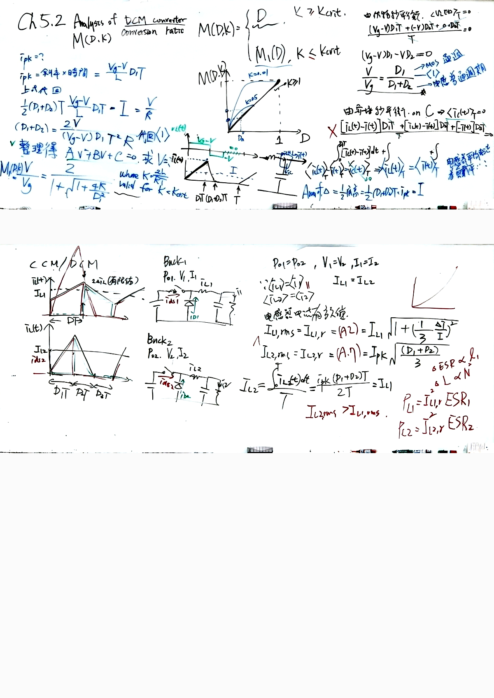

# 📅 2026-11-24 (週二)｜【電力電子】Buck 轉換器之斷續導通模式 (DCM) 分析與損耗比較
> **科目**：`電力電子` ｜ **上課日期**：`2026-11-24` ｜ **原始檔案**：`incoming/電力電子/2026-11-24.pdf`

## 📌 3 分鐘核心摘要
- 深入探討 Buck 轉換器在斷續導通模式（DCM, Discontinuous Conduction Mode）下的工作原理、暫態與穩態特性。
- 詳細推導 DCM 轉換率公式 $M(D, K) = \frac{V}{V_g} = \frac{2}{1 + \sqrt{1 + \frac{4K}{D^2}}}$ ，其中無因次參數定義為 $K = \frac{2L}{R T}$ 。
- 建立連續導通模式（CCM）與 DCM 的交界條件（Boundary Condition），並引入臨界參數 $K_{\text{crit}}(D) = 1 - D$ 與 $R_{\text{crit}}$ 的雙視角比較。
- 分析 DCM 下的電感峰值電流 $i_{pk}$ 、負載平均電流與電感電流均方根值（RMS Current），並延伸探討多相並聯或不同電感量下的導通損耗與 ESR 影響。

---

## 📖 結構化重點筆記（含自動剪貼圖表）
## 1. Buck 轉換器之 CCM 與 DCM 基本定義與交界條件

在電力電子學中，Buck 轉換器（降壓轉換器）的操作模式可分為連續導通模式（CCM, Continuous Conduction Mode）與斷續導通模式（DCM, Discontinuous Conduction Mode）。當負載電流較大時，電感電流 $i_L(t)$ 在一個開關週期 $T$ 內完全不降至零，稱為 CCM；當負載電阻增大或電感量較小時，負載電流較低，導致電感電流在週期結束前降至零，並維持一段時間的零電流狀態，此即為 DCM。

> 🖼️ **Buck轉換器電路、CCM/DCM電感電流波形與邊界條件推導**（擷取自第 1 頁）
> 

**圖表與波形解析**：
上圖展示了 Buck 轉換器在 CCM 與 DCM 下的電感電流 $i_L(t)$ 與開關切換波形。在 CCM 下， $i_L(t)$ 保持大於零的最小值 $I_{L,\min}$ ；而在 DCM 下， $i_L(t)$ 在區間 $D_1 T$ 上升、 $D_2 T$ 下降，並在剩餘的時間內歸零（持續時間為 $D_3 T$ 或由週期扣除）。透過觀察 $i_L(t)$ 的波形，當 $I_{L,\min} > 0$ 時電路操作於 CCM；當 $I_{L,\min} = 0$ 且出現零電流停滯區間時，電路進入 DCM 的邊界。

為了精確劃分 CCM 與 DCM，我們引入無因次參數 $K$ 與臨界參數 $K_{\text{crit}}$ ：

$$
K = \frac{2L}{R T}
$$

當電路工作於交界狀態（BCM, Boundary Conduction Mode）時，電感電流漣波剛好等於平均電流的一半，即：

$$
2 \Delta i_L = I_{L,\max} - I_{L,\min} = I
$$

利用電感伏秒平衡，可推導出邊界條件：

$$
K \le K_{\text{crit}}(D)
$$

其中臨界參數定義為：

$$
K_{\text{crit}}(D) = 1 - D
$$

若 $K > K_{\text{crit}}$ ，則系統操作於 CCM；若 $K < K_{\text{crit}}$ ，則系統操作於 DCM。同理，若定義臨界電阻 $R_{\text{crit}} = \frac{2L}{D' T}$ （其中 $D' = 1 - D$ ），則當 $R > R_{\text{crit}}$ 時為 DCM， $R < R_{\text{crit}}$ 時為 CCM。

---

## 2. DCM 轉換率 $M(D, K)$ 的完整數學推導 (Step-by-Step)

在 DCM 操作下，開關週期 $T$ 被分為三個相異的時間區間： $D_1 T$ （開關導通）、 $D_2 T$ （二極體導通放電）、以及 $D_3 T$ （二極體電流歸零、開關與二極體皆截止）。

### Step 1: 分析各區間之電感電壓與電容電流
- 區間一（ $0 < t < D_1 T$ ，MOSFET 導通）：
 

$$
v_L(t) = V_g - V
$$

- 區間二（ $D_1 T < t < (D_1 + D_2) T$ ，二極體導通）：
 

$$
v_L(t) = -V
$$

- 區間三（ $(D_1 + D_2) T < t < T$ ，二極體截止）：
 

$$
v_L(t) = 0
$$

### Step 2: 應用電感伏秒平衡（Volt-Second Balance）
在穩態下，電感一個週期內的平均電壓必須為零：

$$
\frac{1}{T} \int_{0}^{T} v_L(t) dt = 0
$$

將三個區間代入展開：

$$
\frac{(V_g - V) D_1 T + (-V) D_2 T + 0 \cdot D_3 T}{T} = 0
$$

化簡得：

$$
(V_g - V) D_1 - V D_2 = 0 \implies V_g D_1 - V D_1 - V D_2 = 0
$$

整理可得電壓與導通duty比的關係式：

$$
\frac{V}{V_g} = \frac{D_1}{D_1 + D_2} \quad --- \text{<1>}
$$

### Step 3: 計算電感峰值電流與平均電流
電感峰值電流 $i_{pk}$ 可由區間一的斜率與時間相乘求得：

$$
i_{pk} = \text{斜率} \times \text{時間} = \frac{V_g - V}{L} D_1 T
$$

在 DCM 下，電感電流波形為一三角形，其平均電流 $\langle i_L \rangle$ 等於負載電流 $I = \frac{V}{R}$ 。利用三角形面積法求平均電流：

$$
\langle i_L \rangle = \frac{1}{2} (D_1 + D_2) T \cdot i_{pk} \cdot \frac{1}{T} = \frac{1}{2} (D_1 + D_2) i_{pk} = I = \frac{V}{R}
$$

### Step 4: 代入消去 $i_{pk}$ 與 $D_2$ 求解轉換率 $M$ 
將 $i_{pk}$ 的表達式代入平均電流方程式中：

$$
\frac{1}{2} (D_1 + D_2) \left( \frac{V_g - V}{L} D_1 T \right) = \frac{V}{R}
$$

移項整理以求解 $(D_1 + D_2)$ ：

$$
(D_1 + D_2) = \frac{2 V L}{(V_g - V) D_1 T R}
$$

回代至前面得到的式子 $\langle 1 \rangle$ 中（注意到 $\frac{D_1}{D_1 + D_2} = \frac{V}{V_g}$ ，故 $D_1 + D_2 = D_1 \frac{V_g}{V}$ ），或直接將 $K = \frac{2L}{R T}$ 代入化簡：

經過代數整理，可組裝成關於 $V/V_g$ 的二次方程式：

$$
A \left(\frac{V}{V_g}\right)^2 + B \left(\frac{V}{V_g}\right) + C = 0
$$

最終解得 DCM 下的電壓轉換率公式：

$$
\frac{V}{V_g} = \frac{2}{1 + \sqrt{1 + \frac{4K}{D^2}}}
$$

此公式在 $K < K_{\text{crit}}$ 時完全成立，清楚展現出 DCM 下轉換率不僅與工作週期 $D$ 有關，更強烈受到負載與電感量（即 $K$ 值）的調變。

---

## 3. DCM 轉換率特性曲線與波形解析

> 🖼️ **DCM轉換率M(D,K)特性曲線與多相Buck損耗比較**（擷取自第 2 頁）
> 

**圖表與波形解析**：
上圖描繪了 $M(D, K)$ 轉換率曲線與不同 $K$ 值下的非線性特徵。在橫軸為工作週期 $D$ 、縱軸為轉換率 $M(D, K)$ 的座標系中，當 $K \ge K_{\text{crit}}$ 時，系統維持在 CCM，轉換率呈現簡單的線性關係 $M = D$ ；當 $K$ 小於臨界值（例如 $K = 0.01, 0.05$ 等）時，曲線向上彎曲凸顯，這代表在輕載（DCM）狀況下，輸出電壓會顯著高於 CCM 的預期理論值，這對控制系統的閉迴路補償設計帶來極大的挑戰。

此外，圖中亦比較了兩個不同設計參數的 Buck 轉換器（ $\text{Pol}_1$ 與 $\text{Pol}_2$ ）在多相或不同電感下的電流均方根值（RMS Current）差異：

$$
I_{L1,\text{rms}} = I_{L1} \sqrt{1 + \frac{1}{3} \left(\frac{\Delta i_L}{I}\right)^2}
$$

而對 DCM 而言，均方根電流則需考慮三角波積分：

$$
I_{L2,\text{rms}} = I_{pk} \sqrt{\frac{D_1 + D_2}{3}}
$$

透過精確計算均方根電流，工程師能更準確評估功率開關與電感的導通損耗 ( $P_{\text{loss}} = I_{\text{rms}}^2 \cdot \text{ESR}$ )。

---

## 4. 實務設計考量與損耗比較表

| 比較項目 | 連續導通模式 (CCM) | 斷續導通模式 (DCM) |
| :--- | :--- | :--- |
| **適用負載條件** | 中載至重載 ( $I > \Delta i_L$ ) | 輕載 ( $I < \Delta i_L$ ) |
| **電感電流特性** | 最小值大於零 ( $I_{L,\min} > 0$ ) | 週期內曾歸零 ( $I_{L,\min} = 0$ ) |
| **電壓轉換率 $M$ ** | 僅與 $D$ 有關 ( $M = D$ ) | 同時與 $D$ 及 $K$ 有關 ( $M = \frac{2}{1 + \sqrt{1 + \frac{4K}{D^2}}}$ ) |
| **峰值電流 $i_{pk}$ ** | 相對較低，電流漣波小 | 較高，容易造成磁芯飽和與突波 |
| **控制特性** | 屬於二階系統，含有 L-C 共振極點 | 退化為一階系統，無 L-C 雙極點，控制相對簡單但增益非線性 |
| **導通損耗 ( $P_{\text{loss}}$ )** | 依循標準 $I_{\text{rms}}^2 R_{\text{DS(on)}}$ 計算 | 因峰值電流較大，RMS 電流可能偏高 |

---

## 🖼️ 原始板書/講義高畫質對照（已自動去陰影與銳利化）
<details>
<summary>👉 點此展開查看完整板書原圖（共 2 頁）</summary>

#### 📄 第 1 頁


#### 📄 第 2 頁


</details>

---

## 💡 後續複習提示詞 (Prompt)
```markdown
你現在是「電力電子」領域的教學專家。請根據上述「Buck 轉換器之斷續導通模式 (DCM) 分析與損耗比較」的筆記內容，出 3 題觀念驗證題（包含 1 題陷阱選擇題與 2 題推導/問答題），並附上詳細詳解與評分標準。
```
